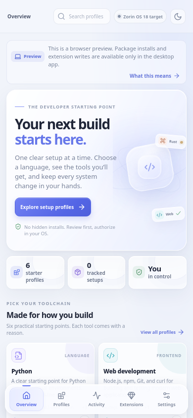

# Zorin DevStart

**One-click, explainable development setup for Zorin OS 18.1 Core.** Choose a Python, Web, C/C++, Java, Rust, or Android starter profile; inspect every APT package first; authorize system changes through the desktop's polkit prompt; and remove only the direct packages this app recorded as newly installed.

> **Status:** frontend checks/build, Rust formatting, and all 10 Rust unit tests pass; unsigned amd64 `.deb` and `.AppImage` packages are built on Ubuntu 24.04. No Zorin OS device install/polkit test has been performed; see the [validation checklist](docs/validation.md) before treating Zorin compatibility as device-verified.
> **Public source:** [uthumany/zorin-devstart](https://github.com/uthumany/zorin-devstart). Tagged `.deb` and `.AppImage` builds are staged as GitHub release drafts for manual review.

### Interface preview




## Why this is Zorin-first

Zorin OS 18.1 Core is based on Ubuntu 24.04 LTS, uses GNOME Shell, and supports APT, Flatpak, Snap, `.deb`, and AppImage software. DevStart deliberately uses **APT for its built-in profiles** because those packages are native to the supported base. The Android profile installs the open-source Java/ADB/Fastboot prerequisites; Android Studio and the Google Android SDK remain a guided, user-accepted step because SDK components and licences are vendor-managed. See [Zorin's technical details](https://zorin.com/os/details/).

### Package caveats are shown, not hidden

Ubuntu Noble's `nodejs` candidate is 18.19.1, while upstream Node 18 is end-of-life; the Web profile warns users to check project requirements and does not add an external repository. The Java profile omits Ubuntu's Gradle 4.4.1 package in favor of a project's checked-in Gradle Wrapper. The Rust profile uses the real APT name `rust-clippy`; Rust Analyzer is a separate editor/toolchain setup because Noble has no `rust-analyzer` package. Sources: [Ubuntu Node.js](https://packages.ubuntu.com/noble/nodejs), [Node.js EOL notice](https://nodejs.org/en/about/eol), [Ubuntu Gradle](https://packages.ubuntu.com/noble/gradle), [Ubuntu Rust availability](https://ubuntu.com/developers/docs/reference/availability/rust/).

## What it does

- Presents six starter profiles with a plain-language reason for each tool.
- Shows each profile package's installed state; the final install review lists only packages that are not already present.
- Runs `apt-get update` and a narrowly scoped `apt-get install` only after the user confirms, using `pkexec` so the system authorization agent—not a bundled root service—handles elevation.
- Records only profile packages that were absent before the install and present after it.
- Offers per-profile uninstall for those recorded packages only. It uses `apt-get remove`, never purge/autoremove, and does not delete projects, SDK data, configuration, or shared dependencies.
- Accepts local JSON profile extensions, limited to metadata and validated APT package names; extensions cannot execute arbitrary commands.
- Keeps profile state and operation history on the device.

## Quick start — developer workstation

Target: x86_64 Zorin OS 18.1 Core. The backend gate currently accepts Zorin OS 18.x (including 18.1) and Ubuntu 24.04 LTS; device-level validation on Zorin is still required. Tauri's Linux prerequisites include WebKitGTK 4.1, GTK/build tools, and Rust; the React frontend additionally needs Node.js. Install the native build prerequisites as documented by [Tauri](https://v2.tauri.app/start/prerequisites/):

```bash
sudo apt update
sudo apt install -y libwebkit2gtk-4.1-dev build-essential curl wget file \
  libxdo-dev libssl-dev libayatana-appindicator3-dev librsvg2-dev pkg-config
```

Install Rust stable using [the official Rust installation guide](https://www.rust-lang.org/tools/install) and Node.js 22.x (the version used by CI) for a reproducible frontend build. From the repository root:

```bash
npm ci
npm run tauri -- dev
```

To build both Linux installers:

```bash
npm run tauri -- build
```

The `.deb` is generated under `src-tauri/target/release/bundle/deb/` and the `.AppImage` under `src-tauri/target/release/bundle/appimage/`. Reduce the AppImage size after building it:

The optimizer requires `squashfs-tools` (`sudo apt install squashfs-tools` on Ubuntu).

```bash
bash scripts/optimize-appimage.sh src-tauri/target/release/bundle/appimage/*.AppImage
```

Review the artifact before installing. Open the `.deb` with Software or install it with `sudo apt install "./src-tauri/target/release/bundle/deb/Zorin DevStart_"*.deb`. To run the AppImage directly:

```bash
chmod +x src-tauri/target/release/bundle/appimage/*.AppImage
src-tauri/target/release/bundle/appimage/*.AppImage
```

Both formats use the host's WebKitGTK 4.1 and GTK 3 runtime libraries (`libwebkit2gtk-4.1-0` and `libgtk-3-0`). The reduced-size AppImage does not bundle those libraries; install the packages on the target system if they are missing. Compatibility with older Linux systems is not guaranteed because core-library requirements such as glibc depend on the Ubuntu 24.04 build baseline. Both formats are unsigned; a Zorin device install and runtime check is still required.

## Try the UI without a Zorin machine

```bash
npm ci
npm run dev
```

The web preview intentionally disables privileged actions and shows a clear desktop-runtime notice. Profile browsing, search, navigation, themes, extension examples, and responsive layout still work. **Never treat web preview as an installer.**

## Build, check, and test

```bash
npm run check
npm run build
cargo test --manifest-path src-tauri/Cargo.toml
```

Desktop build/test dependencies are listed in [the user guide](docs/USER_GUIDE.md). The source repository is public, but the app is unsigned and no release has been publicly published. CI builds and tests the project; a version tag stages a draft GitHub release with `.deb` and `.AppImage` installers for manual review and publication.

## Safety and removal boundaries

DevStart is a desktop convenience layer, not a package manager replacement. Every install has an explanation, a preview of only the packages not already installed, and explicit confirmation. APT changes use polkit authorization and may run package maintainer scripts with system privileges; DevStart validates package names, not package provenance or contents, so approve only packages from repositories you trust. On uninstall, only packages recorded as newly installed by that profile are eligible; packages that were already installed are left alone. DevStart never runs a shell script from a profile extension. APT may keep shared or automatically pulled dependencies after the direct packages are removed; that is intentional to avoid an unsafe blanket `autoremove`.

Uninstalling a profile does not remove this app. Removing DevStart itself does not automatically remove toolchains already installed through it. Use the profile-specific uninstall first if you want those direct packages removed.

## Repository map

```text
src/                       React + TypeScript UI
src-tauri/src/              Tauri commands, APT runner, profile catalog, local state
src-tauri/capabilities/     Tauri v2 application permissions
.github/workflows/          CI and tagged .deb/.AppImage release
.github/dependabot.yml      Weekly GitHub Actions/npm/Cargo update checks
docs/                       User guide, architecture, diagrams, research notes, validation checklist, preview screenshots
```

See [docs/USER_GUIDE.md](docs/USER_GUIDE.md), [docs/ARCHITECTURE.md](docs/ARCHITECTURE.md), [docs/diagrams.md](docs/diagrams.md), [docs/research-notes.md](docs/research-notes.md), [docs/validation.md](docs/validation.md), and [BUILD_PROMPT.md](BUILD_PROMPT.md).

## Free integrations

- **APT + dpkg**: local, native package resolution and installed-state checks; no account or API key.
- **polkit / pkexec**: system authorization for privileged APT operations; uses the active desktop authorization agent.
- **GitHub Actions**: free CI for the public repository and tagged builds, subject to GitHub's current usage limits.
- **GitHub Releases**: a version tag stages a draft `.deb` and `.AppImage` release using the repository's `GITHUB_TOKEN`; a manually dispatched build can refresh assets on an existing draft tag without moving it. A maintainer must review and manually publish the draft. Signing is not configured.
- **Local profile extensions**: JSON manifests need no cloud account and cannot supply executable hooks; APT packages may still run maintainer scripts with system privileges, so trust the package and configured repository.

## Sources

- [Zorin OS technical details](https://zorin.com/os/details/) — base, desktop, supported formats, architecture, support lifecycle.
- [Tauri Linux prerequisites](https://v2.tauri.app/start/prerequisites/) — Linux native libraries, Rust, Node.js.
- [Tauri Debian bundling](https://v2.tauri.app/distribute/debian/) — runtime dependencies and guidance to build on the oldest supported base.
- [Tauri AppImage bundling](https://v2.tauri.app/distribute/appimage/) — direct execution and Linux baseline/glibc compatibility guidance.
- [polkit `pkexec` manual](https://www.freedesktop.org/software/polkit/docs/latest/pkexec.1.html) — privileged program execution model.
- [Android Studio download](https://developer.android.com/studio) and [Android SDK command-line tools](https://developer.android.com/tools) — user-controlled SDK setup and licence acceptance.
- Ubuntu package details for [Node.js](https://packages.ubuntu.com/noble/nodejs), [Gradle](https://packages.ubuntu.com/noble/gradle), and [Rust Clippy](https://packages.ubuntu.com/noble/rust-clippy); [Node.js EOL](https://nodejs.org/en/about/eol) and [Ubuntu Rust versions](https://ubuntu.com/developers/docs/reference/availability/rust/).

## License

MIT; see [LICENSE](LICENSE).
