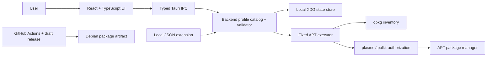
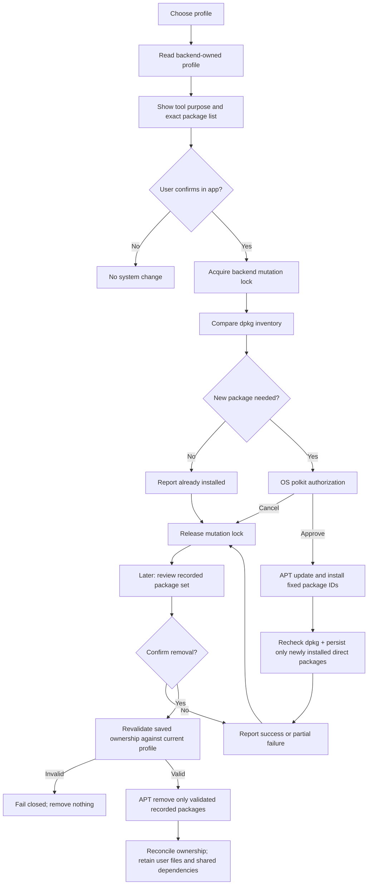
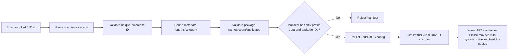
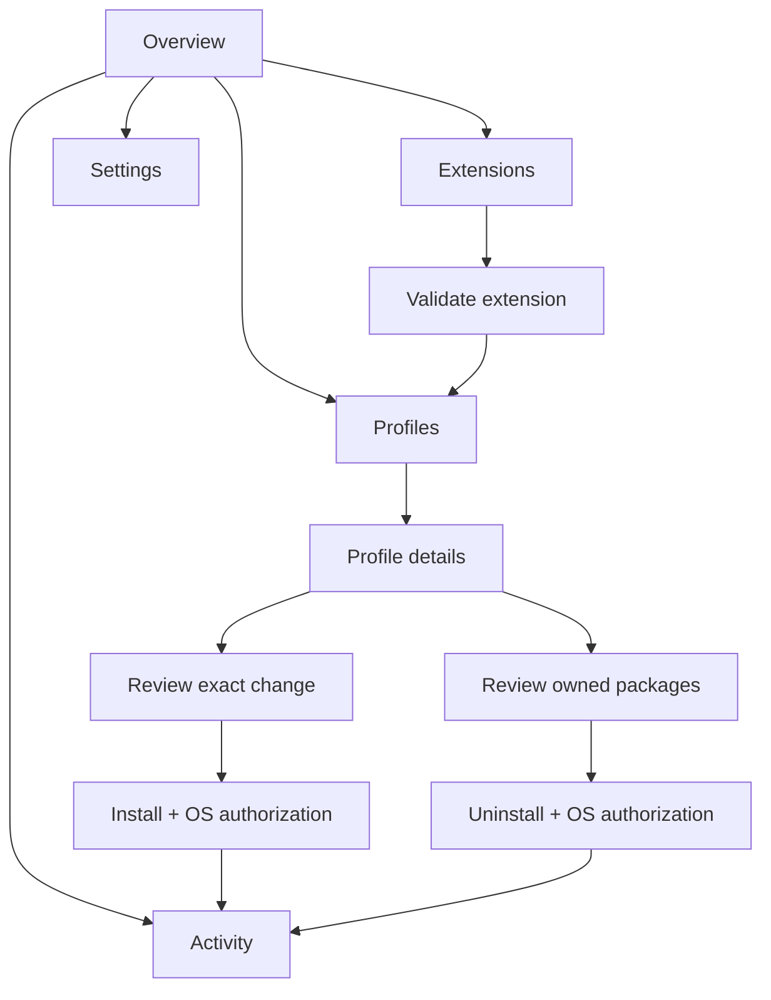
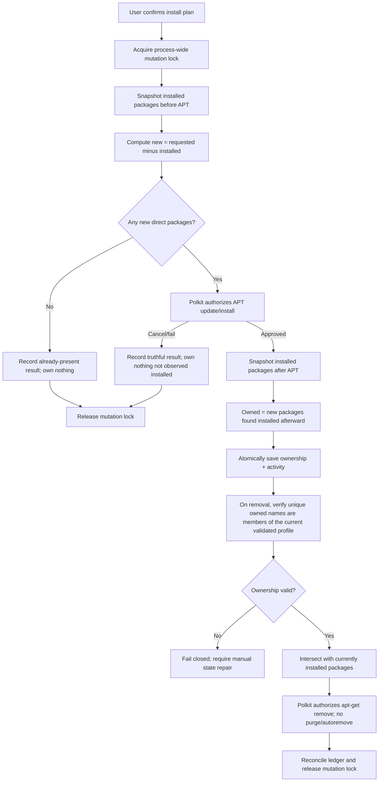

# Wireframes and diagrams

## Desktop overview wireframe

```text
┌──────────────────┬──────────────────────────────────────────────────────────┐
│  Zorin DevStart  │ Search profiles…     Zorin 18 target       Theme  ▢      │
│                  ├──────────────────────────────────────────────────────────┤
│  ◉ Overview      │                                                          │
│  ◇ Profiles      │  Your next build starts here                             │
│  ◷ Activity      │  Choose a starter setup. See every change before it runs.│
│  ⬡ Extensions    │                                                          │
│  ⚙ Settings      │  [6 profiles]   [0 tracked setups]   [local-only state]  │
│                  │                                                          │
│                  │  Python        Web       C / C++                         │
│                  │  Java          Rust      Android                         │
│                  │                                                          │
│                  │  Recent activity               Explainable by default    │
└──────────────────┴──────────────────────────────────────────────────────────┘
```

## Profile review wireframe

```text
┌─────────────────────────────────────────────────────────────────────────────┐
│ Python Developer setup                                       close / back   │
│ A clear starter environment for Python projects.                            │
│                                                                             │
│ TOOL / APT PACKAGE                  WHY IT IS INCLUDED         STATUS       │
│ python3-venv                        isolated project envs      not installed│
│ python3-pip                         package installer           not installed│
│ pipx                               isolated app installs       installed   │
│ …                                                                           │
│                                                                             │
│ ACTION SUMMARY: refresh APT index, then install only new packages shown     │
│ DevStart asks the OS to authorize this exact package operation.              │
│ [Cancel]                              [Continue to installation review]    │
└─────────────────────────────────────────────────────────────────────────────┘
```

## Application architecture



## Setup and removal flow



## Extension validation



## View/navigation flow




## Package ownership lifecycle


